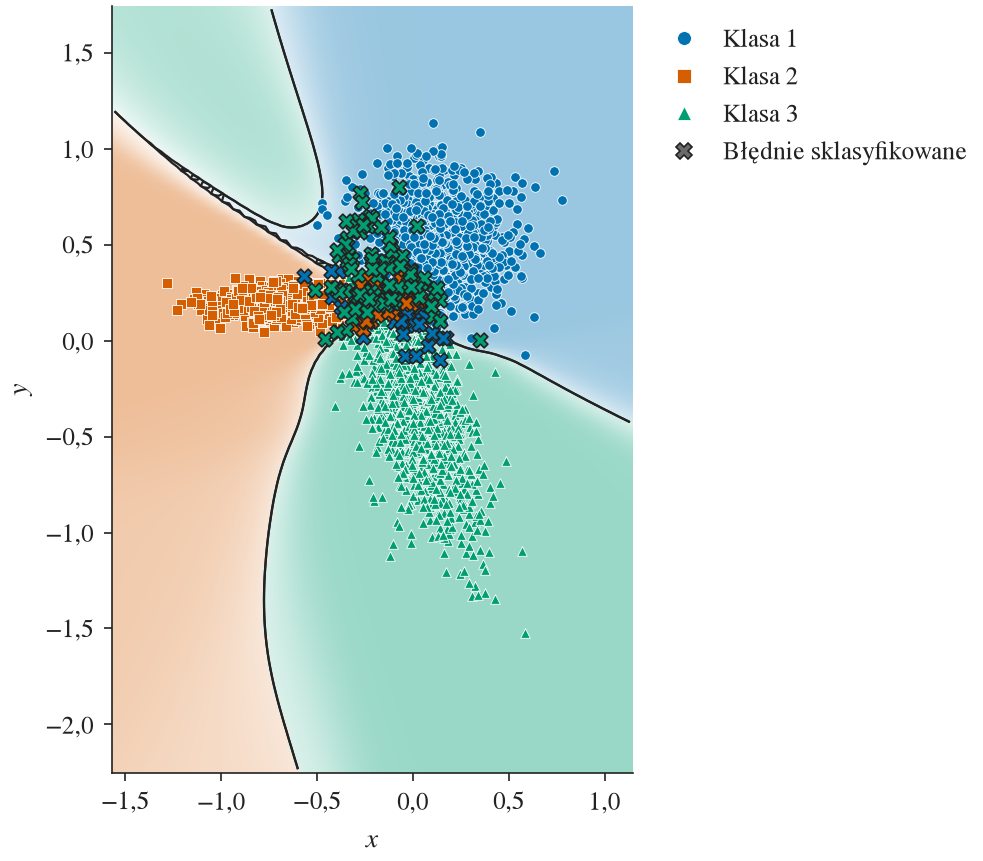
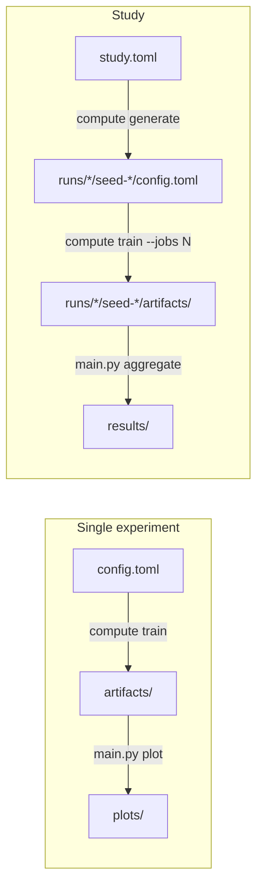
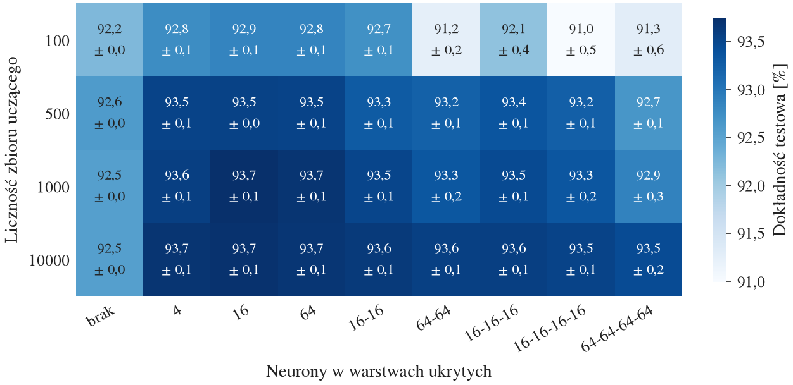
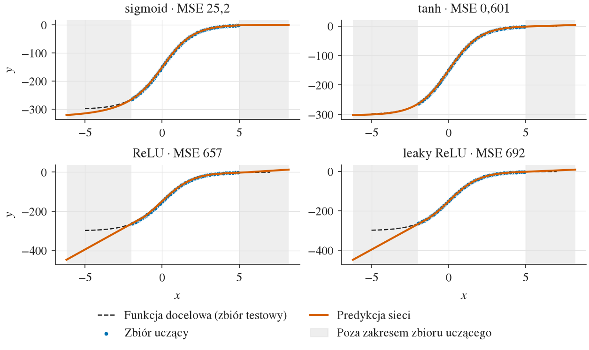
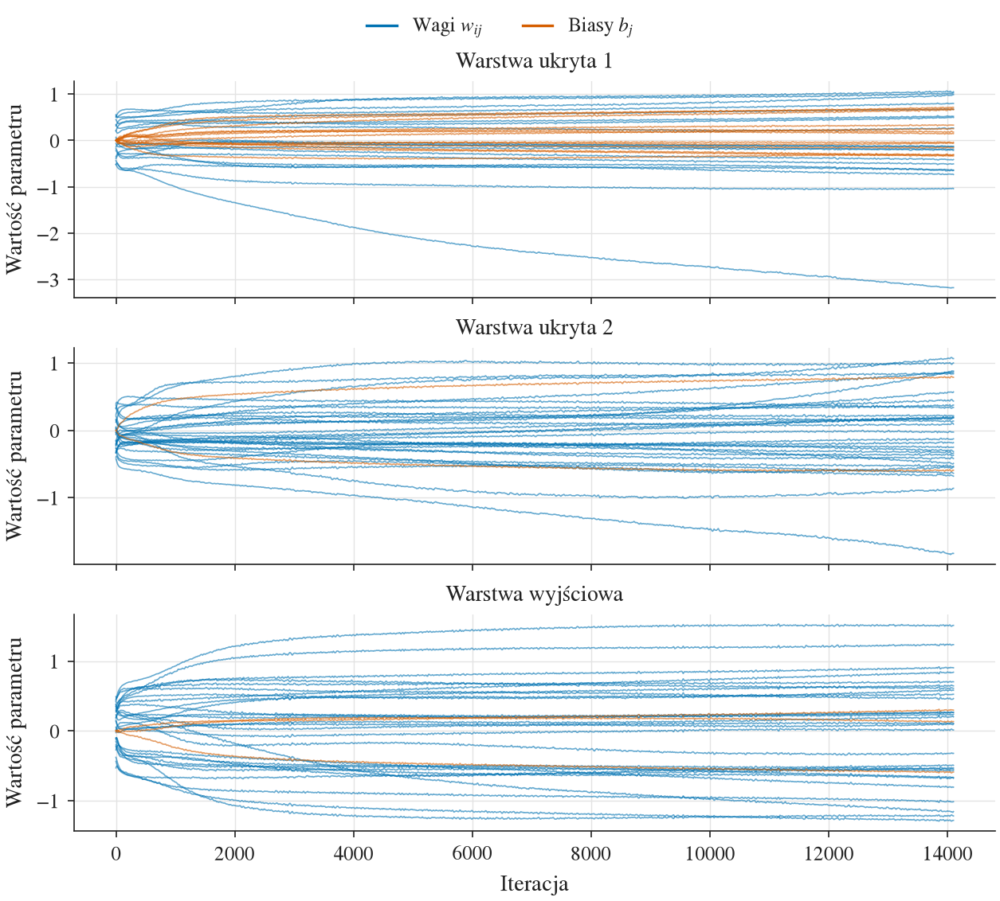

# MlpFromScratch

[](https://github.com/adamgracikowski/MlpFromScratch/actions/workflows/ci.yml)
[](LICENSE)

A multilayer perceptron written from scratch, without neural network libraries: a Rust engine that trains the network and a Python layer that turns its output into plots and statistics. Built for the Neural Networks course.

<!-- source: data/experiments/classification/showcase-three-gauss/plots/decision_boundary.png -->
<p align="center">
  
  <br>
  <em>Decision regions of a 16-16 tanh network on <code>three_gauss</code>, shaded by confidence, with the test samples and the misclassified ones.</em>
</p>

## About

The forward pass, backpropagation, the optimizers and the training loop are implemented by hand on top of plain matrices. The network is used for:

- **regression** of a function f: R -> R,
- **classification** of points in R²,
- **MNIST digit recognition** (part two). It needs no new features, only other hyperparameters, so part one already handles high-dimensional inputs and ten classes.

Part one studied the effect of the activation function, the architecture and the loss function on four datasets, in 2400 training runs. The report (in Polish) is [`docs/report.pdf`](docs/report.pdf).

## Features

- **Network:** fully connected layers stored as matrices (one row per sample), 0 to 4 hidden layers, optional biases. Backpropagation is checked against numerical gradients in unit tests.
- **Building blocks:** hidden activations sigmoid, tanh, ReLU and leaky ReLU; output activations identity, softmax and sigmoid; losses cross-entropy, MSE and MAE; optimizers SGD, momentum and Adam; Xavier, He or uniform initialization.
- **Data:** CSV input, standard or min-max normalization fitted on the training set, stratified training subsets and validation splits, early stopping.
- **Reproducibility:** one seed determines a run. Every source of randomness (data split, initialization, shuffling, weight sampling) has its own random stream, so changing one part of the config does not change the others. Every run records its config and the git commit of the code.
- **Helpful errors:** invalid configs are rejected with all problems at once, each pointing at its line in the file.
- **Studies:** a grid of variants times seeds is described in one file, trained in parallel and aggregated into tables (mean, standard deviation, quartiles) and comparison plots.
- **Plots:** decision regions, regression fits, loss curves, weight trajectories, confusion matrices, drawn at print size and byte-for-byte reproducible.

## How it works

The project has two layers that communicate only through files on disk:

- **Compute layer** ([`src/compute/`](src/compute/README.md), Rust): validates the config, trains the network and writes raw artifacts (`.npy` arrays, a CSV of metrics per epoch, `metadata.json`). It does no plotting.
- **Presentation layer** ([`src/analysis/`](src/analysis/README.md), Python): reads the artifacts and writes plots, tables and Markdown summaries. It does no training.



An experiment lives in `data/experiments/<task>/<name>/`, where `<task>` is `classification`, `regression` or `mnist`. Its `config.toml` holds every parameter, including the seed. A study in `data/experiments/<task>/<study>/` holds a base config, the axes to vary and the seeds in `study.toml`; `compute generate` turns it into one experiment per variant and seed. Configs, study files, plots and study results are committed; artifacts and generated runs are not, since the config and the code version reproduce them.

## Results of part one

Each study varies one factor of a base configuration on one dataset, together with the training set size (100, 500, 1000 and 10000 samples per class or in total), and trains every variant with 10 seeds:

| Factor | Levels | Studies |
|---|---|---|
| activation | sigmoid, tanh (Xavier initialization), ReLU, leaky ReLU (He) | `classification/{simple,three-gauss}-activations`, `regression/{activation,cube}-activations` |
| architecture | hidden layers: none, 4, 16, 64, 16-16, 64-64, 16-16-16, 16-16-16-16, 64-64-64-64 | `classification/{simple,three-gauss}-architectures`, `regression/{activation,cube}-architectures` |
| loss | cross-entropy and MSE with softmax (classification), MSE and MAE (regression) | `classification/{simple,three-gauss}-losses`, `regression/{activation,cube}-losses` |

The base configuration uses tanh, 16-16 (classification) or 32-32 (regression) hidden neurons, Adam with learning rate 0.003 and batch size 32. The plots below are taken from the report, so their labels are in Polish.

### Classification

- A network without hidden layers is enough for `simple`, whose classes are separated by a straight line.
- On `three_gauss` it loses about one percentage point, because it cannot draw curved boundaries. A single hidden layer of 4 neurons closes the gap. No variant exceeds 93.74 % on average, as the clusters overlap.
- Large networks overfit small training sets. On `three_gauss` with 100 samples per class, 64-64, 16-16-16-16 and 64-64-64-64 reach 91.00-91.28 % test accuracy, against 92.85 % for one layer of 16 neurons. The gap between training and test accuracy is up to 8.19 points at 100 samples and at most 0.24 at 10000.
- Activation and loss functions differ by tenths of a percentage point at most.

<!-- source: data/experiments/classification/three-gauss-architectures/results/heatmap.png -->
<p align="center">
  
  <br>
  <em>Test accuracy on <code>three_gauss</code> (mean ± standard deviation over 10 seeds) for every architecture (columns, "brak" = no hidden layer) and training set size per class (rows).</em>
</p>

### Regression

- The error outside the range of the training inputs depends on how the network extends the function. On `activation`, whose target saturates, tanh networks saturate too and reach a median test MSE of 0.600-2.33 outside the range, while ReLU and leaky ReLU networks extend a straight line and reach 1410-2200.
- No network extends `cube`, which grows faster than linearly. Inside the training range, every network with two or more hidden layers beats every network with one.
- Training on MSE gives a 5.91 to 22.6 times lower MSE inside the training range than training on MAE.

<!-- source: data/experiments/regression/activation-activations/results/gallery_1000.png -->
<p align="center">
  
  <br>
  <em>Predictions (orange) of a representative run per hidden activation on <code>activation</code> with 1000 training samples, against the target function (dashed); the grey bands lie outside the training inputs. Titles give the test MSE.</em>
</p>

### Seeds matter

Picking the best variant from a single seed disagrees with picking it from 10 seeds in 38 % of the comparisons in classification and 39 % in regression. In regression such a pick can choose a variant with a 131 times larger median MSE, so every comparison relies on many seeds and on statistics robust to single bad runs.

### Watching a single run

Besides the study comparisons, every experiment gets plots of its own training: data, decision regions or fitted curve, loss per iteration and per epoch, accuracy or MSE per epoch, confusion matrices and the evolution of the weights.

<!-- source: data/experiments/classification/showcase-three-gauss/plots/weights_trajectories.png -->
<p align="center">
  
  <br>
  <em>Sampled weights (blue) and biases (orange) of the two hidden layers and the output layer during training on <code>three_gauss</code>.</em>
</p>

## Results of part two

Five tuning studies chose the configuration for MNIST one factor at a time, on a subset of 10000 training images with 5 seeds, comparing the variants on a validation set held out from the training images. The final configuration then trained on all 60000 training images with 5 seeds; the test set was used only for this final evaluation.

| | Configuration | Test accuracy |
|---|---|---|
| final, 5 seeds | 784-512-10, ReLU (He), min-max scaling, Adam 0.001, batch 32, cross-entropy, early stopping | 97.91 % +- 0.15 |
| submitted network | the same, seed 1 | 97.74 % |

The tuning results, the configuration and how to reproduce the submitted network are described in [`data/experiments/mnist/README.md`](data/experiments/mnist/README.md).

## Getting started

Prerequisites:

- [rustup](https://rustup.rs/). The toolchain (Rust 1.88.0) is pinned in `src/compute/rust-toolchain.toml` and installed automatically.
- [uv](https://docs.astral.sh/uv/). It installs Python 3.13 and the locked dependencies.
- MNIST is not in the repository. `uv run --project src/analysis src/analysis/main.py mnist` downloads it and converts it to CSV, see [`data/datasets/mnist/README.md`](data/datasets/mnist/README.md).

Run everything from the repository root, since the dataset paths in the configs are relative to the current working directory:

```bash
# build the compute layer and install the Python dependencies
cargo build --release --manifest-path src/compute/Cargo.toml
uv sync --project src/analysis

# train one experiment and plot it
cargo run --release --manifest-path src/compute/Cargo.toml -- train data/experiments/classification/showcase-three-gauss
uv run --project src/analysis src/analysis/main.py plot data/experiments/classification/showcase-three-gauss
```

`train` prints the progress and a summary and writes `artifacts/`; `plot` writes the plots and `summary.md` into `plots/` of the experiment. Commented example configs: `data/experiments/classification/example-three-gauss/` and `data/experiments/regression/example-cube/`.

## Reproducing the results

One study: generate its runs, train them in parallel and aggregate them into `results/`:

```bash
cargo run --release --manifest-path src/compute/Cargo.toml -- generate data/experiments/classification/simple-activations
cargo run --release --manifest-path src/compute/Cargo.toml -- train data/experiments/classification/simple-activations --jobs 8
uv run --project src/analysis src/analysis/main.py aggregate data/experiments/classification/simple-activations --plot-runs
```

All 12 studies of part one, one after another (PowerShell 7):

```powershell
pwsh -File scripts/run-studies.ps1                  # every study, the cheapest first
pwsh -File scripts/run-studies.ps1 -Jobs 6 data/experiments/regression/cube-losses
pwsh -File scripts/run-studies.ps1 -ForceAggregate  # aggregate again, e.g. after a plotting change
```

The script can be stopped (Ctrl+C) and started again: trained runs and up-to-date results are skipped. Its output goes to `logs/`. On a laptop the full run takes about 1.5 h of training and 0.5 h of aggregation and writes about 4 GB of artifacts.

The single-run figures of the report come from the showcase experiments `data/experiments/classification/showcase-{simple,three-gauss}/` and `data/experiments/regression/showcase-{activation,cube}/`. Each is the run `tanh__500/seed-1` of the matching `*-activations` study, with weights logged more often:

```bash
cargo run --release --manifest-path src/compute/Cargo.toml -- train data/experiments/classification/showcase-simple data/experiments/classification/showcase-three-gauss data/experiments/regression/showcase-activation data/experiments/regression/showcase-cube --jobs 4
uv run --project src/analysis src/analysis/main.py plot data/experiments/classification/showcase-three-gauss   # and the other three
```

The MNIST studies and the submitted network of part two are reproduced as described in [`data/experiments/mnist/README.md`](data/experiments/mnist/README.md#reproducing-the-submitted-network).

The committed `plots/` and `results/` hold PDFs, CSV tables and `summary.md`; PNG copies are written next to them but not committed.

## Repository layout

```txt
data/
├── datasets/        # classification and regression CSV files; mnist (downloaded)
└── experiments/     # experiments and studies: configs, plots, results
docs/
├── report.tex       # report of part one (Polish, LaTeX) with sections/ and references.bib
├── report.pdf       # the built report
└── images/          # figures of this README
scripts/             # run-studies.ps1, build-tex scripts for the report
src/
├── compute/         # Rust crate: library + `compute` binary
└── analysis/        # Python package managed with uv
.github/workflows/   # CI
```

## Development

CI runs `cargo fmt --check`, `cargo clippy --all-targets -- -D warnings`, `cargo test`, `ruff check`, `ruff format --check` and `pytest`. The commands are listed in the Commands sections of [`src/compute/README.md`](src/compute/README.md#commands) and [`src/analysis/README.md`](src/analysis/README.md#commands).

## License

[MIT](LICENSE)
